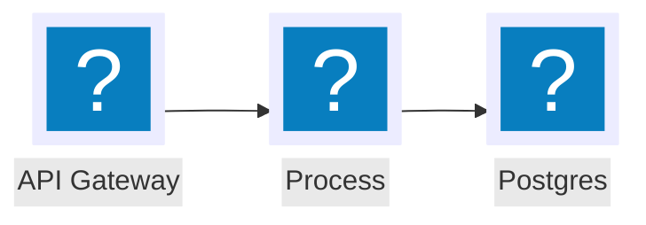
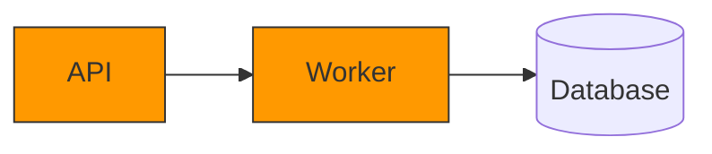
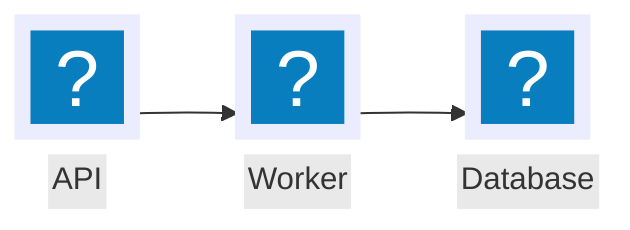
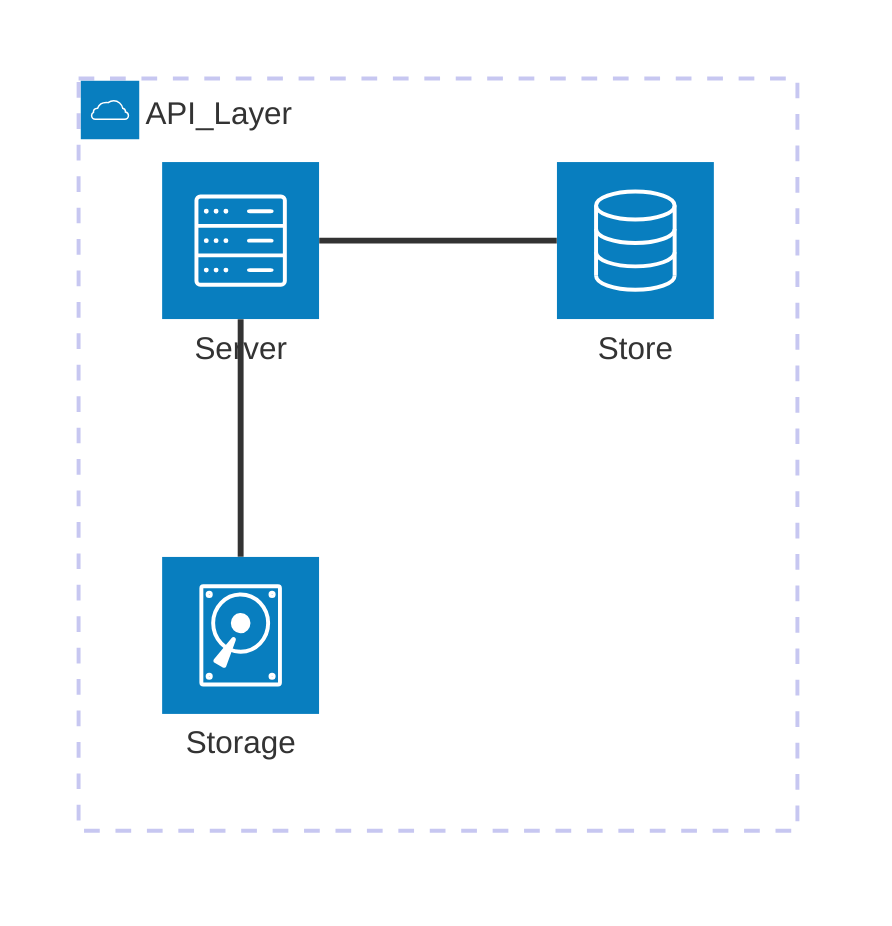

# Mermaid + Iconify: Real Icons in Diagrams

This skill is a **focused supplement** to [`mermaid-syntax`](~/.claude/skills/mermaid-syntax/SKILL.md). That skill covers general syntax and the 20+ common pitfalls. This skill covers **only iconography** — how to put real product logos in a Mermaid diagram instead of colored rectangles.

## Am I the right skill?

You landed here because you mentioned icons in a diagram. Sanity check:

- **Designing a NEW workflow?** → `diagram-workflow-design` first. Icons come after structure is settled.
- **Authoring a flowchart (no icons needed)?** → `diagram-workflow-authoring`.
- **Mermaid parse error / syntax issue?** → `mermaid-syntax`.
- **Multi-engine output or non-mermaid creation?** → `mermaid-studio`.
- **Unsure where to start?** → `diagram-meta` (top-level router).

Stay here when: you're explicitly putting product logos / icons (Iconify packs) into a Mermaid diagram (`architecture-beta` or the v11.3+ flowchart `icon` shape).

Two Mermaid features carry icons. Pick one based on the diagram's purpose:

| Feature | Use for | Mermaid version |
|---|---|---|
| `architecture-beta` | Cloud / system architecture diagrams (services, groups, edges) | v10.9+ (still beta as of v11.x) |
| Flowchart `icon` shape | Any flowchart that wants logos on existing nodes | v11.3.0+ |

If the diagram is already a `flowchart` and you want to keep its structure, use the icon shape. If you're starting fresh and the diagram is a system topology, `architecture-beta` is purpose-built.

## 1. Iconify Naming (read this first)

Both features pull icons from [Iconify](https://iconify.design) — 200,000+ icons across 200+ packs.

**Reference format:** `prefix:name`

| Pack | npm package | Prefix | Use for |
|---|---|---|---|
| logos | `@iconify-json/logos` | `logos` | Brand/product logos (full color: `logos:aws`, `logos:postgresql`) |
| Material Design Icons | `@iconify-json/mdi` | `mdi` | General UI glyphs (`mdi:database`, `mdi:cloud`) |
| Simple Icons | `@iconify-json/simple-icons` | `simple-icons` | Monochrome brand marks |
| Devicon | `@iconify-json/devicon` | `devicon` | Programming language / tool logos |
| Carbon | `@iconify-json/carbon` | `carbon` | IBM Carbon design system |
| Font Awesome Solid | `@iconify-json/fa6-solid` | `fa6-solid` | Generic icons |

Browse packs and find icon names at https://icon-sets.iconify.design/.

**The prefix is set when you register the pack** — by convention it matches the package name suffix (`@iconify-json/logos` → `logos`), but the registrar can override it. With `mmdc --iconPacks @iconify-json/logos`, the registered name is the segment after `/` — so references stay `logos:aws`.

## 2. Flowchart Icon Shape (v11.3.0+)

The most common case: an existing `flowchart LR/TB` diagram with styled nodes. You want real icons without rewriting.

### Syntax

```
nodeId@{ shape: icon, icon: "prefix:name", form: "square", label: "Display Text", pos: "b", h: 48 }
```

| Param | Values | Default | Notes |
|---|---|---|---|
| `shape` | `icon` | required | The discriminator |
| `icon` | `"prefix:name"` | required | Must be in a registered pack |
| `form` | `square` / `circle` / `rounded` | none | Background shape behind the icon. Omit for bare icon. |
| `label` | any string | none | Displayed alongside the icon |
| `pos` | `t` / `b` | `b` | Label position (top or bottom) |
| `h` | integer | `48` | Icon height in px; **48 is the minimum** |

### Working example



### Image shape (alternative)

For logos not in any Iconify pack, use a URL-based image shape:

```
node@{ img: "https://example.com/logo.svg", label: "Service", pos: "t", w: 60, h: 60, constraint: "on" }
```

`constraint: "on"` preserves aspect ratio. Defaults to `off`.

### Migration pattern: colored boxes → icons

Existing diagram:



Add icons without changing structure or edges:



Edges, subgraphs, click directives, and `classDef` for *non-icon* nodes all keep working. Only the per-node declaration changes. `classDef` does **not** style icon shapes — the icon brings its own visuals.

## 3. architecture-beta

Purpose-built for cloud/system topology diagrams. Different grammar from `flowchart`.

### Syntax primitives

```
architecture-beta
    group {id}({icon})[{title}]                    %% optional, can nest with `in {parent}`
    service {id}({icon})[{label}] in {parent}      %% `in` is optional
    junction {id} in {parent}                      %% optional 4-way connector

    {id}{{group}}?:{T|B|L|R} <?--> ?{T|B|L|R}:{id}{{group}}?
```

Direction specifiers (`T`/`B`/`L`/`R`) are **mandatory on edges** — they say which side of each node the edge attaches to. `<` and `>` add arrowheads on the corresponding ends.

### Built-in icons (no pack needed)

`cloud`, `database`, `disk`, `internet`, `server`. That's the full list. Anything else requires a registered Iconify pack.

### Working example with built-in icons



### Working example with Iconify icons (registered pack name `logos`)

```mermaid
architecture-beta
    group aws(logos:aws)[AWS_Account]

    service gateway(logos:aws-api-gateway)[Gateway] in aws
    service fn(logos:aws-lambda)[Function] in aws
    service rds(logos:postgresql)[Postgres] in aws

    gateway:R --> L:fn
    fn:R --> L:rds
```



### Architecture-beta limitations (the "beta" is real)

- **Labels are restricted to `[a-zA-Z0-9_ ]`.** Hyphens, parens, slashes, colons all break the parser. Use underscores: `[API_Gateway]` not `[API-Gateway]`. (See pitfall #18 in [mermaid-syntax](~/.claude/skills/mermaid-syntax/SKILL.md).)
- **No `classDef` styling.** Architecture-beta does not honor flowchart-style class definitions. Visual customization is limited to the icons themselves.
- **Layout is automatic and often awkward.** No manual positioning beyond `T/B/L/R` edge anchors. Complex diagrams may produce odd routing — the engine prioritizes correctness over aesthetics.
- **Edges into/out of groups need `{group}` modifier.** To draw an edge from a service to a group boundary: `serviceId{groupId}:R --> L:otherId`.
- **Junctions are the only way to model fan-out cleanly.** Four-way connectors with no visual; declared `junction j1 in parent`.
- **No subgraph-of-subgraph beyond what `group ... in parent` supports.** Nesting works but rendering may break with deep hierarchies.

If the diagram fights you on any of the above, switch to `flowchart` with the icon shape — it has the full flowchart toolkit (subgraphs, classDef, click, all edge types) plus icons.

## 4. Rendering with mmdc (mermaid-cli)

This is where icon-rich diagrams diverge from plain Mermaid: **icons need a registered pack, and registration happens at render time**.

### CLI flag

```bash
mmdc -i diagram.mermaid -o diagram.svg \
     --iconPacks @iconify-json/logos @iconify-json/mdi
```

`--iconPacks <icons...>` accepts space-separated `@iconify-json/*` package names. mermaid-cli fetches each pack's `icons.json` from `https://unpkg.com/<pkg>/icons.json` at render time — **packages do not need to be locally installed**. The registered prefix is the segment after `/` (`@iconify-json/logos` → `logos`).

### Config file alternative

```json
// mmdc-config.json
{
  "iconPacks": ["@iconify-json/logos", "@iconify-json/mdi"]
}
```

```bash
mmdc -i diagram.mermaid -o diagram.svg -c mmdc-config.json
```

### registerIconPacks (in-app embedding)

If you embed Mermaid in a webpage rather than rendering with mmdc, register packs explicitly:

```javascript
import mermaid from 'mermaid';

mermaid.registerIconPacks([
  {
    name: 'logos',
    loader: () => fetch('https://unpkg.com/@iconify-json/logos@1/icons.json')
                    .then(res => res.json()),
  },
]);
```

Or with bundled npm packages:

```javascript
import { icons } from '@iconify-json/logos';
mermaid.registerIconPacks([{ name: icons.prefix, icons }]);
```

The `name` field becomes the prefix used in diagram source — pick the same name your authors expect.

## 5. Rendering surface differences

Icon support is **not uniform** across renderers. Verify on your target:

| Renderer | Architecture-beta | Flowchart icon shape | Icon pack registration |
|---|---|---|---|
| mermaid.live | Yes | Yes | Pre-loaded with `logos`, `mdi`, others — usually "just works" |
| mmdc CLI (`mermaid-cli`) | Yes | Yes (v11.3+ build) | Must pass `--iconPacks` |
| GitHub markdown | Yes (recent) | Partial — depends on GH's bundled mermaid version | None — only built-in `architecture-beta` icons render |
| Obsidian Mermaid plugin | Depends on plugin version | Depends | Usually no pack registration; built-ins only |
| VS Code preview extensions | Varies | Varies | Usually no pack registration |

**Practical rule:** If the diagram will be viewed in a generic markdown renderer (GitHub, Obsidian without configuration), prefer **built-in `architecture-beta` icons** (`cloud`/`database`/`disk`/`internet`/`server`) so the diagram degrades gracefully. Use Iconify packs only when you control the render pipeline (mmdc-generated SVG checked into the repo, or a custom-bundled web app).

In this codebase, the staging hook regenerates `.svg` from `.mermaid` via mmdc — to use Iconify, the hook's `mmdc` invocation must include `--iconPacks`. Verify before committing.

## 6. Gotchas and verification

- **Unknown icon name silently renders blank or as a missing-icon glyph.** No error; you just get an empty box. Always grep the rendered SVG for `<image` or `<svg>` content for each icon node before committing.
- **`logos:` icons are full-color and large.** They visually dominate small diagrams. Drop to `mdi:` (monochrome) or scale `h` higher for balance.
- **Icon names use hyphens, not slashes.** `logos:aws-lambda` not `logos:aws/lambda`.
- **The `@N` version suffix in CDN URLs matters.** `@iconify-json/logos@1` pins major version 1; mmdc fetches without a pin and may drift. If a diagram suddenly breaks, the upstream pack may have shifted icon names.
- **mermaid-cli version vs core mermaid version drift.** The flowchart icon shape needs both the core mermaid bundled in mmdc to be ≥ 11.3.0 *and* mmdc itself to support `--iconPacks`. Run `mmdc --version` and check what mermaid version it bundles.
- **Architecture-beta label parser is strict.** A trailing space, a hyphen, or a stray `(` in a label produces a confusing parse error pointing at the line below. Strip labels to `[a-zA-Z0-9_ ]` first when debugging.
- **`form: "square"` adds a tile background; bare icons can collide with edges.** For dense diagrams, prefer `form: "square"` or `"rounded"` so edges anchor cleanly.
- **No `classDef` for icon nodes.** Don't expect `class api aws-style` to color a `shape: icon` node.

## 7. Decision tree

```
Need icons in a Mermaid diagram?
│
├── Diagram is system/cloud architecture topology?
│   └── Yes → architecture-beta
│       ├── Built-in icons sufficient (cloud/db/disk/internet/server)?
│       │   └── Yes → ship; renders everywhere
│       └── No → register Iconify pack via mmdc --iconPacks
│           └── Confirm render target supports pack registration
│
└── Diagram is a flowchart / process / sequence-of-steps?
    └── Flowchart icon shape (v11.3+)
        ├── Existing flowchart with styled boxes?
        │   └── Migrate per-node to @{ shape: icon, ... }, keep edges
        └── New diagram?
            └── Author with icon shapes from the start
```

## 8. Cross-references

- **`mermaid-syntax`** — escaping, reserved words, common errors. Read first if the diagram won't parse at all. Pitfall #18 covers architecture-beta label restrictions.
- **`diagram-workflow-authoring`** — authoring conventions (color, classDef, legends). Note: `classDef` does not style icon shapes; this skill's icon nodes are visually self-contained.
- **`diagram-workflow-design`** — design process for workflow diagrams (phase vs stage, structural honesty, iterative verification).
- **`diagram-style`** (`dev-docs/conventions/diagram-style.md` inside the JKRE repo — relative path that only resolves when this skill is loaded from inside that repo; do not treat as a global path) — the project's classDef palette. When mixing icon nodes and styled rectangles, keep both visual languages consistent (e.g., color edge styles match the icons' brand hues).
- **Diagrams in this repo are auto-rendered to SVG on stage** — see global rule "Diagrams: Mermaid → SVG" in `~/.claude/CLAUDE.md`. Edits to icon-bearing `.mermaid` files require the staging hook's `mmdc` to be invoked with `--iconPacks`.

## 9. Field-validated lessons (2026-04-28 JKRE migration)

Verified via a 14-diagram production migration. Update this section when subsequent migrations surface new lessons.

### Path A (`architecture-beta`) is silently broken in mmdc v11.12

Three independent failure modes, ALL of them produce a misleading "error SVG" with HTTP-200 success at the CLI level:

1. **Hyphens in service labels crash the parser.** `[Credit-card issuers]` → `Syntax error` SVG. Strip hyphens to spaces.
2. **`group → service` edges crash the renderer** with `TypeError: Cannot read properties of undefined (reading 'in')` from `ArchitectureDB.addEdge`. Workaround: connect individual services, not the group.
3. **YAML frontmatter (`title:`, `config:`) silently rejected** — entire render becomes an error SVG. Strip frontmatter from architecture-beta diagrams.

**Recommendation:** Default to flowchart icon shape (Path B). Reach for architecture-beta only for pure cloud-topology diagrams with no nested groups, no hyphens, no frontmatter.

CI must check rendered SVGs for `aria-roledescription="error"` to catch these — `mmdc` exits 0 on parse failure.

### Pre-commit `mermaid → svg` regenerator hook flag

If your repo uses a staging hook to regenerate SVGs from `.mermaid` sources, the hook's `mmdc` invocation **must** include `--iconPacks @iconify-json/mdi` (and any other packs in use). Without it, icon-shape nodes render as missing-icon placeholders silently. The render exits 0 and the broken SVG is committed.

Also: when adding an icon pack to a project, update the hook before the first commit that uses it.

### HTML inline image pattern (multi-icon labels in one node)

Mermaid's `icon` shape only supports ONE icon per node. For nodes that need TWO icons (e.g., a "Human + AI collaboration" box with [person][+][robot]), use a single regular node with an HTML label:

```
COLLAB[" &nbsp;<b style='font-size:28px;color:#9370DB'>+</b>&nbsp; <br/><b>Human + AI collaboration</b><br/><small>...</small>"]:::approval
```

Requirements:
- `securityLevel: loose` in frontmatter (already a Path B requirement)
- Iconify URL pattern: `https://api.iconify.design/{prefix}/{name}.svg?color=%23HEX` — `%23` is `#` URL-encoded
- Match Mermaid's default theme color: `#9370DB` (medium purple, the default stroke color)

**Caveat:** these `` tags reference the URL at view time and are NOT inlined into the rendered SVG (unlike `--iconPacks`-resolved icons, which are embedded as path data). Offline viewing of the SVG shows broken images for HTML-img icons only. Acceptable for browser-viewed output; not acceptable for fully-offline archival.

### Naming icons for `?color=` queries

The mdi pack's icons are monochrome and accept the URL color param. Brand-color packs (`logos:`) ignore it. Use:

| Pack | `?color=` honored? | Notes |
|---|---|---|
| `mdi` | ✅ | Default monochrome; tint with `?color=%239370DB` etc. |
| `material-symbols` | ✅ | Same behavior as mdi |
| `simple-icons` | ⚠️ | Single-color brand marks; honors color but distorts intent |
| `logos` | ❌ | Multi-color brand logos; param has no effect |

### When agents migrate, verify before promoting

If you delegate icon migration to a sub-agent, do NOT directly promote the agent's output to canonical without a structural diff against HEAD. We caught content drift on slides 13/14: the agent restructured the tenant-forwarding flow (added an approval gate that contradicted the user's "pure pass-through" intent) and compressed descriptive labels into pill-form on slides 02/09. The fix was to revert affected files to HEAD and re-apply icons surgically.

The verification pattern: `git show HEAD:<file>` vs working tree, list every node/edge/label that exists in HEAD but is missing from working tree, and check before committing.

### Iconify `?color=` URL parameter

Beyond the multi-icon label use case above, the URL parameter is useful any time you serve Iconify icons via `` rather than `--iconPacks`. Format:

- Color: `?color=%23RRGGBB` (`%23` is `#` URL-encoded), or named CSS colors (`?color=purple`)
- Combine: `?color=%239370DB&width=48&height=48`

Browse all params: https://docs.iconify.design/api/svg.html

## Authoritative sources (verified 2026-04-28)

- Architecture-beta syntax: https://mermaid.js.org/syntax/architecture.html
- Flowchart icon shape: https://mermaid.js.org/syntax/flowchart.html (search "icon shape")
- Icon pack registration: https://mermaid.js.org/config/icons.html
- mermaid-cli `--iconPacks`: https://github.com/mermaid-js/mermaid-cli (README + `mmdc -h`)
- Iconify icon browser: https://icon-sets.iconify.design/

## Related

- **Need deeper docs?** Use the `documentation-lookup` skill — it routes lookups to Dash (if a docset is installed), Context7, or web search. If the docs aren't available in any source, use the `vendor-docs` skill to acquire them.
