# Mermaid Diagram Syntax Guide

Comprehensive syntax reference for generating error-free Mermaid diagrams. Prevents common mistakes and supports Mermaid v11 features including flowcharts, sequence diagrams, class diagrams, state diagrams, ER diagrams, Gantt charts, and more.

**Test diagrams at:** https://mermaid.live/

**Prefer `flowchart` over `graph`:** Both work, but `flowchart` is the modern syntax with better feature support.

## Friction-budget rule (read first if you're 2+ iterations into a layout problem)

Mermaid is the right default — fast to write, renders inline in markdown previews everywhere, has the lowest authoring friction. Stick with mermaid for typical workflows, sequence diagrams, ER diagrams, and any single-direction flowchart.

**Consider switching to d2** if you've hit any of these *and* a quick fix isn't obvious:

- You're trying to mix layout directions across nested containers (e.g. outer LR + inner TB) and `direction` directives aren't being honored. Both dagre (default) and ELK have a single global direction — per-subgraph `direction` is dagre-ignored and only partially honored by ELK. **TALA would handle this but is mermaid-incompatible.**
- You need >3 iterations on layout alone (not content), or auto-layout repeatedly produces something obviously wrong after each tweak.
- You're piling up invisible-edge hacks to force ranking and the diagram source is getting harder to read than it would be in a more structured tool.
- Icon-heavy architecture diagram (cloud provider logos, tech-stack icons). Mermaid icons are limited to Font Awesome via `fa:` prefix; d2's `icon:` takes any URL.

Switching is a *fallback*, not a default — the cost is losing inline GitHub/Obsidian/mermaid.live rendering and committing a parallel `.d2 → .svg` render hook. Pay that cost only when mermaid's friction visibly exceeds the loss. See `d2-diagrams` skill for the migration table and the invisible-edge layout-shaping pattern.

## Am I the right skill?

You landed here because you're touching a `.mermaid` file or hit a syntax error. Sanity check:

- **Designing a workflow (operator gates, wait states, re-entry)?** → `diagram-workflow-design` first.
- **Applying authoring conventions (classDef, shapes, colors, click directives, labels)?** → `diagram-workflow-authoring`.
- **Picking which diagram type to use?** → `diagram-selection`.
- **Unsure where to start?** → `diagram-meta` (top-level router for the diagram cluster).

If you're debugging a parse error or looking up escape rules / reserved words / v11 syntax — stay here.

## Critical Rules (Prevent 90% of Errors)

### 1. Special Character Escaping

**Always wrap text containing special characters in double quotes:**

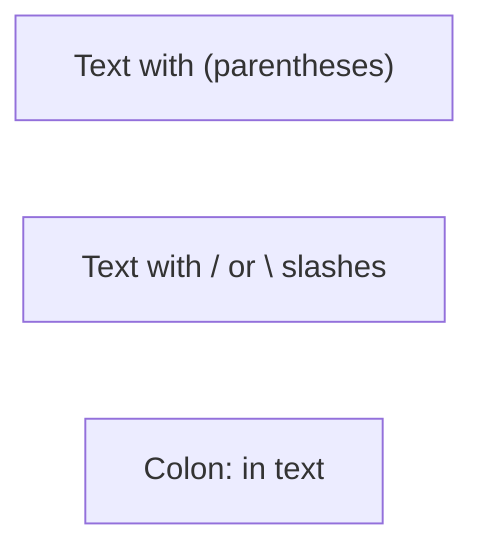

**Characters requiring quotes:** `( ) [ ] { } / \ : ; # @ ! ? < > " '`

### 2. Reserved Words (Not Just "end"!)

Multiple reserved words break diagrams. Use quoted labels with safe IDs:

```mermaid
flowchart LR
    node1["end"]           %% Safe: quoted with different ID
    node2["default"]       %% Safe: "default" is also reserved
    node3["End"]           %% Safe: capitalized
```

**All reserved words (use quoted labels):**
- `end`, `default`
- `style`, `linkStyle`, `classDef`, `class`
- `call`, `href`, `click`, `interpolate`

**Pattern:** `safeId["reserved word text"]` instead of `reserved[text]`

### 3. Node ID Starting Characters

Nodes starting with `o` or `x` create unintended edge types:

```mermaid
flowchart LR
    orderNode[Order]    %% Good: full word
    oNode[O-Node]       %% Bad: might create circle edge
```

**Solution:** Use descriptive IDs, avoid single letters `o` or `x` at start.

### 4. HTML Entity Codes for Semicolons

In sequence diagrams, semicolons define line breaks. Use `#59;` for literal semicolons:

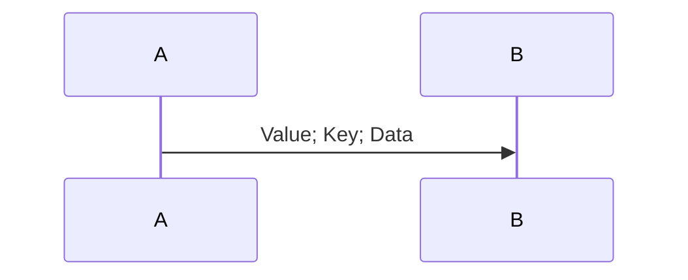

### 5. Comments Must Use %%

Single `%` breaks diagrams. Always use `%%`:

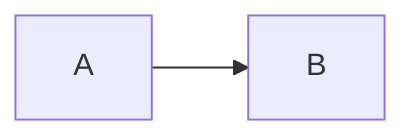

**A bare `%%` (no content after) is a parser bug in Mermaid 11.x flowcharts** — the empty comment gets tokenized as a node id and shows up as a stray `%%` node in the rendered SVG. Affects `flowchart` only; `stateDiagram-v2` parses bare `%%` correctly.

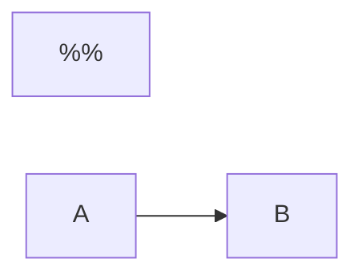

**Workaround.** When you want to visually separate two blocks of comments, put any character on the line. A single dot is unobtrusive:


Or just use blank lines outside of `%%` for separation. Render-check after every edit (§ Rendering); a `grep -c '%%' diagram.svg` of the rendered output should be `0`.

### 6. Subgraph with HTML Tags

Wrap subgraph titles containing `<br/>` in quotes:

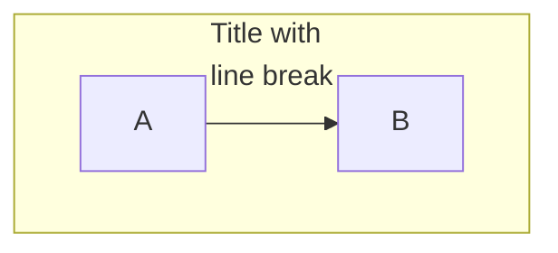

### 7. Style Property Escaping

Escape commas in `stroke-dasharray` with backslash:


### 8. Frontmatter Must Be First Line

The `---` for frontmatter MUST be the only content on line 1:

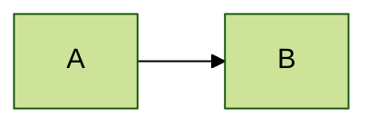

**Wrong:** Any whitespace or content before `---` breaks the diagram.

### 9. Mindmap `<` Character Bug

In mindmaps, `<` renders as `&lt;`. Use words instead:

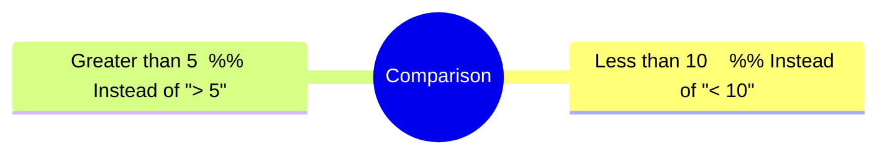

### 10. Class Diagram Colon Limitations

Colons in class member types are tricky. Use return type syntax:

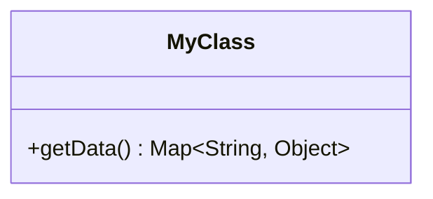

**Note:** Complex generic types with colons may not render correctly.

### 11. Nested Subgraph Linking Bug

Linking to both parent AND nested subgraph causes syntax error:

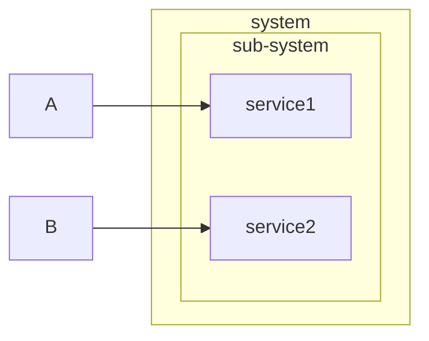

**Workaround:** Link to nodes inside subgraphs, not the subgraph ID itself.

### 12. Subgraph Direction Inheritance

If subgraph nodes link to outside, direction is **ignored** (inherits parent):

```mermaid
flowchart LR
    A --> B
    subgraph sub [My Subgraph]
        direction TB  %% Ignored if C links outside!
        C --> D
    end
    B --> C  %% This external link forces LR direction
```

**Rule:** Subgraph direction only works if all nodes stay internal.

### 13. v11 Arrowless Edges Bug (v11.0-11.4)

In Mermaid v11.0 to v11.4.x, the `---` (line without arrow) syntax is broken and shows arrows:

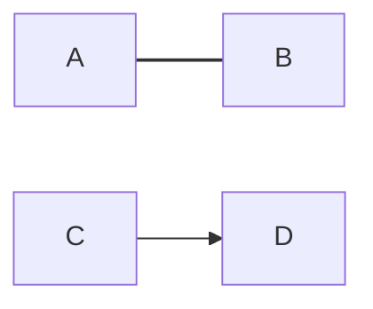

**Fix:** Upgrade to Mermaid v11.5.0 or later.

### 14. v11 Markdown-by-Default Breaking Change

In v11, ALL node labels render as Markdown by default (breaking change from v10):

```mermaid
flowchart LR
    %% v10: plain text, v11: renders as Markdown
    A[**bold** and _italic_]

    %% Problem: underscores in text become italic
    B["file_name_here"]  %% Use quotes to prevent issues
```

**Note:** Only bold (`**`) and italic (`_` or `*`) are supported. Inline code with backticks may not work.

#### 14a. ALWAYS use HTML `<b>`/`<i>` for inline formatting in node labels

Even though v11 supports markdown `**bold**` and `_italic_`, **prefer HTML tags `<b>...</b>` and `<i>...</i>` for cross-renderer compatibility**. Two reasons:

1. **Older renderers display `**` literally.** Markdown bold inside flowchart node labels was only added in Mermaid **v9+**. Obsidian's bundled Mermaid, IDE plugins, and other static viewers may ship older Mermaid versions where `**bold**` renders as the literal asterisks `**bold**`. The diagram looks correct under modern `mmdc` but broken everywhere else.
2. **Markdown is not processed inside explicit `<div>` wrappers.** When you wrap a label in `<div style='text-align: left;'>...</div>` for layout, Mermaid stops processing markdown inside it — but `<b>` and `<i>` continue to work because they're plain HTML inheriting from the surrounding SVG.

`<b>` and `<i>` have been supported in flowchart labels since Mermaid v8 and work in every renderer.

```mermaid
%% WRONG: markdown bold — breaks in older renderers, breaks inside <div> wrappers
flowchart LR
    A["**Watcher fires** our callback."]
    B["<div style='text-align: left;'>**Bold text** that won't render</div>"]

%% RIGHT: HTML tags — universal
flowchart LR
    A["<b>Watcher fires</b> our callback."]
    B["<div style='text-align: left;'><b>Bold text</b> that renders everywhere</div>"]
```

**Rule of thumb:** In `.mermaid` source, reach for `<b>` and `<i>`. Reserve markdown `**` and `_` for prose contexts (commit messages, ADRs, README.md).

**Verification after rendering:**

```bash
# Asterisks should NOT survive into the rendered SVG. If grep finds any, the bold isn't taking effect.
grep -c '\*\*' diagram.svg   # expect 0
```

The global `mermaid-validate.sh` hook also warns when it sees `**...**` patterns in `.mermaid` sources.

### 15. Configuration Limits (Secure Settings)

`maxTextSize` (default: 50,000 chars) and `maxEdges` (default: 500) are **secure settings** that CANNOT be set via frontmatter:


**Workaround:** These must be set via `mermaid.initialize()` in JavaScript, not in diagram config.

### 16. linkStyle Hex Color as Last Attribute Bug

Hex color as the LAST attribute in linkStyle causes parsing error:

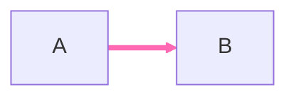

**Workaround:** Put hex color before other attributes, or use CSS color names.

### 17. Class Diagram Namespace Limitations

Relationships and notes MUST be defined OUTSIDE namespace blocks:

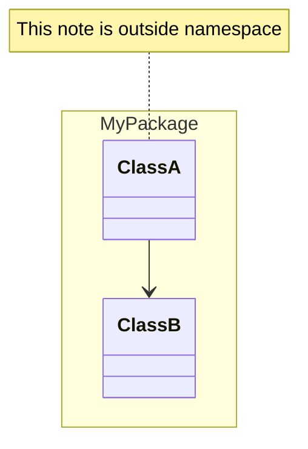

**Limitation:** Nested namespaces not supported. Use flat structure.

### 18. Architecture Diagram Label Characters

Architecture node labels only support `[a-zA-Z0-9_ ]`. Hyphens and special chars break:

```mermaid
architecture-beta
    %% BAD: service db[Cloud-Name]  (hyphen breaks)
    %% GOOD: use underscore or spaces
    service db(database)[Cloud_Name]
```

### 19. Click-Through Navigation (`click` Directive)

Use `click NODE_ID "url" "tooltip"` to make nodes navigable in rendered SVGs. This enables drill-down between linked diagrams.

```mermaid
flowchart LR
    A[Overview] --> B[Detail]
    %% Navigates to detail.svg when A is clicked
    click A "detail.svg" "Open detail view"
    click B "https://example.com" "Open docs"
```

**Click directive forms** (all officially supported per https://mermaid.js.org/syntax/flowchart.html#interaction):

```
click NODE "url" "tooltip"          %% implicit href, tooltip optional
click NODE "url" "tooltip" _blank   %% with target (_self|_blank|_parent|_top, unquoted per official syntax)
click NODE href "url" "tooltip"     %% explicit href form
click NODE call myCallback()        %% JS callback (in-browser only; receives node ID, requires window.myCallback registered)
```

**Critical pitfalls:**

- **Argument separator must be a single space.** Multiple consecutive spaces (e.g. for column alignment) cause `Parse error ... Expecting ... got 'SPACE'`. The parser cannot tolerate `click A   "url"   "tip"`.
  ```
  %% BAD: extra spaces between args (alignment)
  click NODE_A     "a.svg"     "Open A"

  %% GOOD: exactly one space between args
  click NODE_A "a.svg" "Open A"
  ```
- **`click` is a reserved word.** Don't use it as a node ID.
- **Tooltip is optional but recommended.** Without it, hover gives no context.
- **Relative paths work.** `"detail.svg"` resolves relative to the rendered SVG's location. Use this for sibling diagram drill-down.
- **`securityLevel` controls in-browser click activation, not SVG embedding.** Four valid values:
  - `strict` (default) — **disables `click` directives in browser-rendered Mermaid** (mermaid.js, Mermaid Live Editor, embedded markdown previews). HTML in labels is also stripped.
  - `loose` — required for click to work in browser viewers; allows HTML in labels too.
  - `antiscript` — enables click + HTML in labels but strips `<script>` tags as a defense.
  - `sandbox` — disables clicks entirely; renders into a sandboxed iframe.

  **`mmdc` (CLI / static SVG) emits `<a xlink:href="...">` regardless of `securityLevel`** — the static SVG is the only artifact in that case, and the click is just an SVG anchor.

```mermaid
---
config:
  securityLevel: loose
---
flowchart LR
    A --> B
    click A "a.svg" "Open A"
```

**Verification:** After rendering, grep the SVG for `<a xlink:href="..."` to confirm links embedded:
```bash
grep -oE '<a [^>]*href="[^"]*"' diagram.svg
```

## Mermaid v11 New Features

### Hand-Drawn Look

```mermaid
%%{init: {"look": "handDrawn"}}%%
flowchart LR
    A[Sketchy] --> B[Style]
```

### Bidirectional Arrows (Sequence)

```mermaid
sequenceDiagram
    A <<->> B: Bidirectional
    A <<-->> B: Bidirectional dotted
```

### Configuration Directive

```mermaid
%%{init: {
    "theme": "dark",
    "flowchart": {"curve": "linear"}
}}%%
flowchart LR
    A --> B
```

## Diagram Type Quick Reference

### Flowchart Direction

| Syntax | Direction |
|--------|-----------|
| `flowchart TB` | Top to Bottom |
| `flowchart TD` | Top Down (same as TB) |
| `flowchart BT` | Bottom to Top |
| `flowchart LR` | Left to Right |
| `flowchart RL` | Right to Left |

### Node Shapes

| Syntax | Shape |
|--------|-------|
| `A[text]` | Rectangle |
| `A(text)` | Rounded rectangle |
| `A([text])` | Stadium |
| `A[[text]]` | Subroutine |
| `A[(text)]` | Cylinder (database) |
| `A((text))` | Circle |
| `A{text}` | Diamond |
| `A{{text}}` | Hexagon |
| `A>text]` | Asymmetric |

### Edge Types

| Syntax | Type |
|--------|------|
| `A --> B` | Arrow |
| `A --- B` | Line (no arrow) |
| `A -.- B` | Dotted line |
| `A ==> B` | Thick arrow |
| `A -.-> B` | Dotted arrow |
| `A --text--> B` | Arrow with text |
| `A -- text --- B` | Line with text |

### Subgraph Syntax

```mermaid
flowchart TB
    subgraph GroupName["Display Title"]
        direction LR
        A --> B
    end
    C --> GroupName
```

## Sequence Diagram Essentials

### Message Arrow Types

| Syntax | Description |
|--------|-------------|
| `A->B` | Solid line, no arrow |
| `A-->B` | Dotted line, no arrow |
| `A->>B` | Solid line, arrowhead |
| `A-->>B` | Dotted line, arrowhead |
| `A-xB` | Solid line, cross end |
| `A-)B` | Solid line, open arrow (async) |

### Participant Definition

```mermaid
sequenceDiagram
    participant A as Alice
    actor B as Bob
    A->>B: Hello
```

### Activation

```mermaid
sequenceDiagram
    A->>+B: Request
    B-->>-A: Response
```

Or explicit:

```mermaid
sequenceDiagram
    A->>B: Request
    activate B
    B-->>A: Response
    deactivate B
```

### Control Flow

```mermaid
sequenceDiagram
    alt Success
        A->>B: OK
    else Failure
        A->>B: Error
    end

    opt Optional
        A->>B: Maybe
    end

    loop Every minute
        A->>B: Ping
    end

    par Parallel
        A->>B: Task1
    and
        A->>C: Task2
    end
```

### Notes

```mermaid
sequenceDiagram
    Note right of A: Single line note
    Note over A,B: Spanning note
```

## Class Diagram Essentials

### Class Definition

```mermaid
classDiagram
    class Animal {
        +String name
        +int age
        +makeSound()
    }
```

### Visibility Modifiers

| Symbol | Meaning |
|--------|---------|
| `+` | Public |
| `-` | Private |
| `#` | Protected |
| `~` | Package/Internal |

### Relationships

| Syntax | Meaning |
|--------|---------|
| `A <\|-- B` | Inheritance (B extends A) |
| `A *-- B` | Composition |
| `A o-- B` | Aggregation |
| `A --> B` | Association |
| `A ..> B` | Dependency |
| `A ..\|> B` | Realization |

### Cardinality

```mermaid
classDiagram
    Customer "1" --> "*" Order : places
```

## State Diagram Essentials

### Basic States

```mermaid
stateDiagram-v2
    [*] --> State1
    State1 --> State2: transition
    State2 --> [*]
```

### Composite States

```mermaid
stateDiagram-v2
    state Parent {
        [*] --> Child1
        Child1 --> Child2
    }
```

### Choice and Fork

```mermaid
stateDiagram-v2
    state choice <<choice>>
    State1 --> choice
    choice --> State2: if condition
    choice --> State3: else

    state fork <<fork>>
    State4 --> fork
    fork --> State5
    fork --> State6
```

## Common Error Patterns

### Error 1: Unquoted Special Characters

```
%% BAD - breaks parsing
A[Click here (optional)]
B[User: Admin]

%% GOOD - quoted text
A["Click here (optional)"]
B["User: Admin"]
```

### Error 2: Reserved Word "end"

```
%% BAD - breaks diagram
A --> end
subgraph end

%% GOOD - quoted or capitalized
A --> End
A --> ["end"]
subgraph "End Phase"
```

### Error 3: Semicolon in Sequence Diagram

```
%% BAD - treated as line break
A->>B: key;value;data

%% GOOD - HTML entity
A->>B: key#59;value#59;data
```

### Error 4: Nested Quotes

```
%% BAD - quote conflict
A["Say "Hello""]

%% GOOD - use single quotes inside
A["Say 'Hello'"]
%% Or use HTML entity
A["Say #quot;Hello#quot;"]
```

### Error 5: Colon Without Quotes in Flowchart

```
%% BAD - colon breaks node text
A[Step 1: Initialize]

%% GOOD - quoted
A["Step 1: Initialize"]
```

## Other Diagram Types (Quick Start)

### ER Diagram

```mermaid
erDiagram
    CUSTOMER ||--o{ ORDER : places
    ORDER ||--|{ LINE-ITEM : contains
```

### Gantt Chart

```mermaid
gantt
    title Project Timeline
    dateFormat YYYY-MM-DD
    section Phase 1
        Task A :a1, 2024-01-01, 30d
        Task B :after a1, 20d
```

### Pie Chart

```mermaid
pie title Distribution
    "A" : 40
    "B" : 30
    "C" : 30
```

### Git Graph

```mermaid
gitGraph
    commit
    branch develop
    commit
    checkout main
    merge develop
```

## Validation Checklist

Before finalizing any Mermaid diagram:

1. [ ] All text with special characters is quoted
2. [ ] No reserved words as node IDs (`end`, `default`, `style`, `class`, etc.)
3. [ ] No node IDs starting with single `o` or `x`
4. [ ] Semicolons in sequence messages use `#59;`
5. [ ] Nested quotes use single quotes or HTML entities
6. [ ] Subgraph titles are quoted if containing `<br/>` or special chars
7. [ ] Diagram type declaration is correct (`flowchart`, not `flow-chart`)
8. [ ] Comments use `%%` (not single `%`)
9. [ ] `stroke-dasharray` commas escaped with `\,`
10. [ ] Frontmatter `---` is on the very first line (no whitespace before)
11. [ ] Mindmaps avoid `<` character (use words)
12. [ ] No links to both parent and nested subgraphs (link to nodes inside instead)
13. [ ] Subgraph direction only reliable if all nodes stay internal
14. [ ] If using `---` (arrowless), verify Mermaid v11.5+ or use workaround
15. [ ] Underscores in labels may render as italic in v11 (use quotes)
16. [ ] `maxTextSize`/`maxEdges` can't be set in frontmatter (secure settings)
17. [ ] linkStyle: hex color NOT as last attribute (or use color names)
18. [ ] classDiagram: relationships and notes OUTSIDE namespace blocks
19. [ ] architecture-beta: labels use only `[a-zA-Z0-9_ ]`, no hyphens
20. [ ] Test at https://mermaid.live/ before committing

## Additional Resources

### Reference Files

For detailed syntax of each diagram type:
- **`references/flowchart-complete.md`** - All 30+ node shapes, edge styling, subgraph nesting
- **`references/sequence-complete.md`** - All message types, boxes, breaks, critical sections
- **`references/class-state-complete.md`** - Class annotations, state concurrency, ER diagrams, notes
- **`references/other-diagrams.md`** - Gantt, Pie, Git Graph, Mindmap, Timeline

### Example Files

Working examples in `examples/`:
- **`examples/flowchart-examples.md`** - Common flowchart patterns
- **`examples/sequence-examples.md`** - API flow, auth flow patterns

### Scripts

- **`scripts/validate-mermaid.sh`** - Basic syntax validation helper

### External Resources

- **Live Editor:** https://mermaid.live/ - Test and debug diagrams
- **Official Docs:** https://mermaid.js.org/intro/syntax-reference.html
- **GitHub:** https://github.com/mermaid-js/mermaid

### Internal Resources

- **[diagram-workflow-authoring skill](~/.claude/skills/diagram-workflow-authoring/SKILL.md)** — authoring conventions (classDef styling, color semantics, legends, flow guidelines). This skill (`mermaid-syntax`) covers syntax correctness; `diagram-workflow-authoring` covers authoring quality. Under Architecture B of the diagram skill cluster, `mermaid-syntax` auto-invokes broadly on any mermaid work; `diagram-workflow-authoring` auto-invokes only when an authoring decision (classDef / shape / label / click-through) is in play AND the file is a flowchart — otherwise it's invoked explicitly via `diagram-meta`.
- **[diagram-workflow-design skill](~/.claude/skills/diagram-workflow-design/SKILL.md)** — design process for new workflow diagrams (phase vs stage, structural honesty, iterative verification).

### Source

This skill was vendored from [awesome-skills/mermaid-syntax-skill](https://github.com/awesome-skills/mermaid-syntax-skill) at commit `933d1a6` on 2026-03-20. No upstream tracking — to update, re-clone and diff.

## Related

- **Need deeper docs?** Use the `documentation-lookup` skill — it routes lookups to Dash (if a docset is installed), Context7, or web search. If the docs aren't available in any source, use the `vendor-docs` skill to acquire them.

---

## Local Addendum (not upstream — do not remove on re-vendor)

Findings from local usage, added below the vendored content per this project's convention of never editing vendored text directly. Re-apply this section after any re-clone/diff update from upstream.

- **mermaid-cli (`mmdc`) 11.12 clips or overlaps any subgraph title longer than one line.** Cluster height is computed before the title wraps (~200px allotted). The `.mmd` source parses clean — the defect only shows up in the rendered raster/SVG. Workaround: keep subgraph titles to one line. **Verified** 2026-09-24 (hit on four diagrams in one session, fixed each time by shortening the title). Also recorded in memory `discovery-mermaid-cluster-title-wrap-clips` (admin-technical project memory) — this entry is the skill-level pointer, not a duplicate.
- **`securityLevel` in mermaid front matter does not change `mmdc` (static SVG) output at all.** The same source rendered at `strict` / `loose` / `sandbox` produced byte-identical SVGs in local testing, with `<a xlink:href>` anchors present in all three (consistent with the existing note above that `mmdc` emits click anchors regardless of `securityLevel`). The setting only matters for **in-browser** rendering (mermaid.js, Mermaid Live Editor, embedded previews) per the table above — not for anything produced by the CLI. **Additionally: a static SVG's click-through anchors are only live when the SVG file is opened directly in a browser.** They are inert when the SVG is embedded as ``, and inert in GitHub's and Obsidian's markdown previews (both sandbox rendered SVGs). If drill-down needs to work from a doc preview, it won't via `click` alone. **Verified** 2026-09-24 (three renders at different `securityLevel` values, diffed identical; click behavior checked directly-opened vs. ``-embedded vs. GitHub/Obsidian preview).
